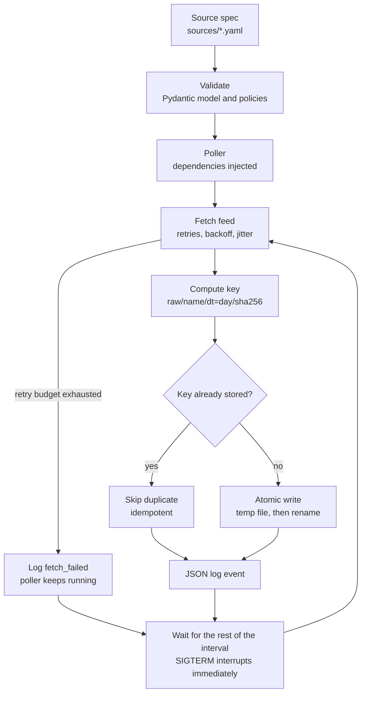
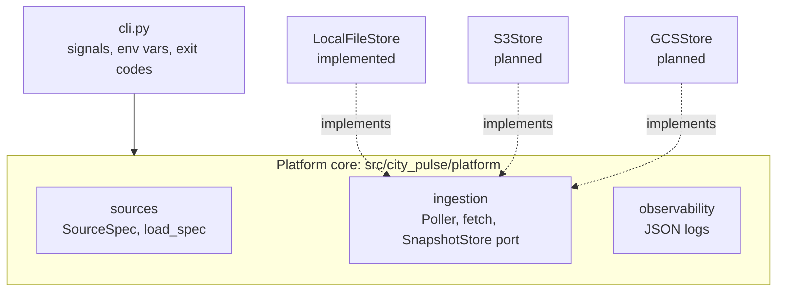

# Ingestion architecture

How a real-time source gets from a URL to the raw layer. Decisions: [ADR-001](../adr/001-poller-plus-pubsub-ingestion.md), [ADR-008](../adr/008-platform-approach.md).

## Poll cycle

One poller runs per source. The top row runs once at startup; the rest repeats every `polling.interval_seconds`.



- Only transient errors are retried (429, 5xx, network); 403 and 404 fail fast.
- A source outage is logged and does not stop the poller; unexpected exceptions (bugs) are not caught, so the process exits and the orchestrator restarts it.
- The same payload on the same day maps to the same key, so duplicates are never stored twice.

## Code structure: ports and adapters

The platform core depends only on the `SnapshotStore` port. Storage backends implement it, so adding one does not change the core.



## Storage layout

```
raw/<source_name>/dt=<YYYY-MM-DD>/<sha256>.<ext>
```

Hive-style `dt=` partitions let Spark, BigQuery and Athena read only the days a query needs.
